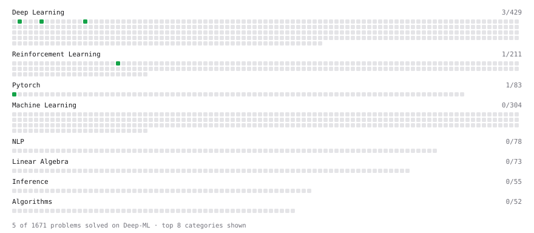

# Deep-ML

My machine learning practice from [Deep-ML](https://www.deep-ml.com). Every solution here was written by hand.

**6** solved · 6 problems · 0 labs · 0 math

[**Browse the interactive portfolio**](https://jaiprakash1824.github.io/deep-ml/) to replay this filling in over time.

## Problems

| | Difficulty | Solved | |
| --- | --- | --- | --- |
| [Create a Float Tensor from a Python List](https://www.deep-ml.com/problems/880) | easy | 2026-10-27 | [solution](problems/0880-create-a-float-tensor-from-a-python-list) |
| [Implementation of Log Softmax Function](https://www.deep-ml.com/problems/39) | easy | 2026-02-11 | [solution](problems/0039-implementation-of-log-softmax-function) |
| [KL Divergence Between Two Normal Distributions](https://www.deep-ml.com/problems/56) | easy | 2026-02-11 | [solution](problems/0056-kl-divergence-between-two-normal-distributions) |
| [KL Divergence Estimator for GRPO](https://www.deep-ml.com/problems/225) | easy | 2026-02-11 | [solution](problems/0225-kl-divergence-estimator-for-grpo) |
| [Softmax Activation Function Implementation ](https://www.deep-ml.com/problems/23) | easy | 2026-02-11 | [solution](problems/0023-softmax-activation-function-implementation) |
| [Implement Self-Attention Mechanism](https://www.deep-ml.com/problems/53) | medium | 2026-02-12 | [solution](problems/0053-implement-self-attention-mechanism) |

---

_This file is regenerated by Deep-ML on every push._
